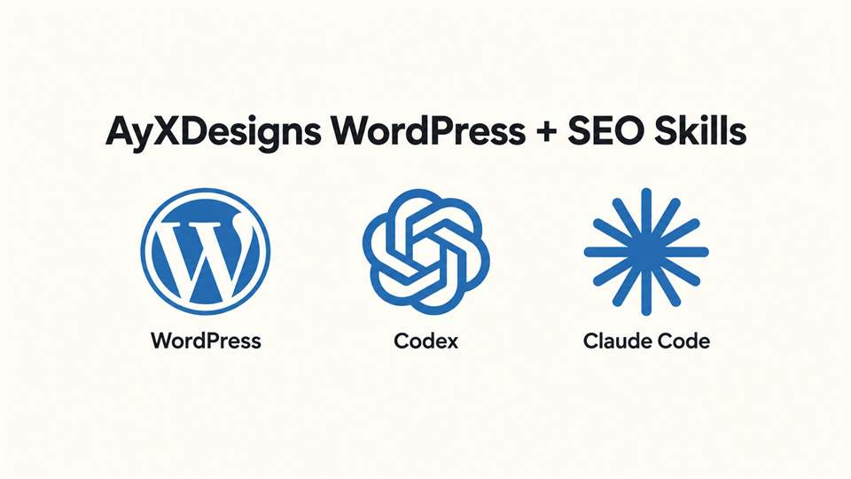

# AyXDesigns WordPress Skill Pack



> 14 focused skills for WordPress theme delivery, SEO workflows, and safer releases in Codex or Claude Code.

If this pack helps your work, please star the repository.

Practical agent skills for secure, editable WordPress theme delivery and SEO work.

Built for teams using local WordPress environments, block or classic themes, controlled releases, accessible visitor journeys, and evidence-led SEO. The pack helps an AI coding agent select the smallest workflow that fits the work instead of applying a generic checklist to every request.

> [!IMPORTANT]
> This is a skill pack, not a WordPress theme or plugin. It gives an agent operational guidance; it does not install WordPress, change a website, or publish anything by itself.

## What it covers

- Local XAMPP and WP-CLI setup, with options presented before installation or configuration.
- WordPress theme architecture, editable-content ownership, block patterns, templates, accessibility, performance, and release practice.
- Theme triage, content migrations, Contact Form 7 assurance, preview recovery, and release evidence.
- Search research, content planning, on-page implementation, structured data, sitemap readiness, and performance monitoring.
- A delivery router that selects one primary workflow and avoids unnecessary tools, plugins, deployment, or data changes.

## Included skills

| Skill | Use it for |
| --- | --- |
| `wp-delivery-router` | Select the smallest suitable workflow for a WordPress or SEO request. |
| `wp-local-stack-setup` | Diagnose and safely configure local XAMPP and WP-CLI work. |
| `wp-theme-foundations` | Apply the shared technical, editorial, accessibility, security, SEO, and release baseline. |
| `wp-site-experience-build` | Plan, design, build, and verify an editable WordPress site. |
| `site-preview-and-publish` | Prepare previews, resolve preview issues, and publish only with approval. |
| `wp-theme-triage` | Understand an unfamiliar theme before changing it. |
| `wp-theme-content-migrations` | Change editable content, options, seeders, and stored records safely. |
| `wp-cf7-form-assurance` | Build and verify private, dependable Contact Form 7 journeys. |
| `wp-theme-release-gate` | Produce evidence that one exact theme package is release-ready. |
| `wp-seo-discovery-brief` | Define search-aware page architecture and ownership. |
| `wp-seo-build-and-release` | Implement WordPress SEO and verify launch readiness. |
| `seo-research-and-strategy` | Research markets, competitors, backlinks, local search, and opportunities. |
| `seo-content-system` | Plan useful content, clusters, comparison pages, and scalable page families. |
| `seo-measure-and-monitor` | Capture search baselines and investigate meaningful change. |

## Install

The commands below use the [`skills` CLI](https://github.com/vercel-labs/skills). This pack is published as `AyXDesigns/wordpress-theme-seo-and-build`.

### Codex

Install every skill globally:

```bash
npx skills add AyXDesigns/wordpress-theme-seo-and-build --skill '*' -g -a codex -y
```

Install one skill for the current project:

```bash
npx skills add AyXDesigns/wordpress-theme-seo-and-build --skill wp-theme-foundations -a codex
```

### Claude Code

Install every skill globally:

```bash
npx skills add AyXDesigns/wordpress-theme-seo-and-build --skill '*' -g -a claude-code -y
```

Install one skill for the current project:

```bash
npx skills add AyXDesigns/wordpress-theme-seo-and-build --skill wp-theme-foundations -a claude-code
```

### Both agents

```bash
npx skills add AyXDesigns/wordpress-theme-seo-and-build --skill '*' -g -a codex -a claude-code -y
```

### Manual installation

Copy one or more directories from `skills/` into the target agent's skills directory.

| Agent | Global directory | Project directory |
| --- | --- | --- |
| Codex | `~/.codex/skills/` | `.agents/skills/` |
| Claude Code | `~/.claude/skills/` | `.claude/skills/` |

Restart the agent or begin a new session after installation if it does not discover the new skills immediately.

## How to use the pack

Ask naturally. The agent should choose the relevant skill from its description.

Examples:

```text
Set up a local XAMPP WordPress project. Show the available install options before changing anything.

Review this inherited theme and explain the lowest-risk way to make its homepage editable.

Create a release manifest for the current theme package. Do not deploy it.

Plan the search strategy for a local charity website, then identify what evidence is still needed.
```

For an unclear request, start with `wp-delivery-router`. It identifies the environment, delivery risk, stored-data impact, and intended outcome before routing to one primary workflow.

## Operating principles

- Visitor-facing copy stays editable through the agreed WordPress surface.
- Existing content, settings, form records, and metadata are treated as migration data, not disposable fixtures.
- Local, staging, preview, and production states stay distinct.
- Installation, deployment, paid services, new plugins, and destructive changes require explicit authority.
- A form success message does not prove stored delivery data; release claims require observable evidence.
- Time-sensitive WordPress, browser, search-engine, schema, and platform facts should be checked against current primary documentation.

## Repository layout

```text
skills/
  wp-delivery-router/
  wp-local-stack-setup/
  wp-theme-foundations/
  ...
VALIDATION.md
ORIGIN.md
LICENSE
```

Each skill is a directory containing a `SKILL.md` file with YAML frontmatter. `wp-theme-foundations` also includes a focused reference for deeper theme-delivery guidance.

## Validation and release

Run the scenarios in [VALIDATION.md](VALIDATION.md) before publishing a new version. Review every changed file for customer information, credentials, production URLs, personally identifiable information, and copied material before release.

## Provenance and licence

This repository contains newly authored operational instructions. See [ORIGIN.md](ORIGIN.md) for the maintained-source statement.

Copyright (c) 2026 AyXDesigns. All rights reserved. See [LICENSE](LICENSE).

